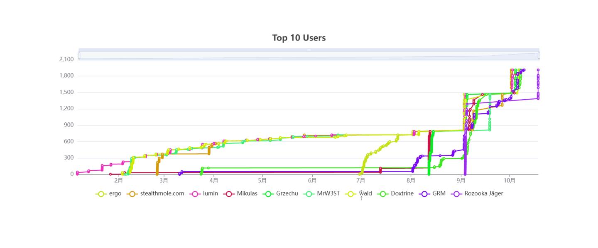
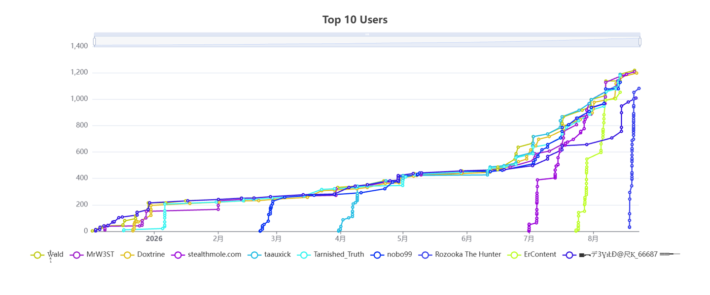

# Yann

_{ I build systems for questions a search box cannot answer.

**Project ARGUS** turns fragments across images, maps, archives,
and the open web into traceable intelligence.

Search retrieves.

**ARGUS investigates.** }_

## Now

Building **Project ARGUS**, an agentic intelligence system for multimodal
investigation, autonomous research, and evidence-backed results.

> Reduce the distance between an unknown and a verified answer.

## Fieldwork

**Two platforms. Two days. Two global Top 10s.**

<table width="100%">
  <thead>
    <tr>
      <th width="50%" align="center">OSINT UK</th>
      <th width="50%" align="center">OSINT Industries</th>
    </tr>
  </thead>
  <tbody>
    <tr>
      <td width="50%" align="center" valign="top"></td>
      <td width="50%" align="center" valign="top"></td>
    </tr>
    <tr>
      <td align="center"><strong>Peak Global #1</strong></td>
      <td align="center"><strong>Peak Global #8</strong></td>
    </tr>
    <tr>
      <td align="center">Entered global Top 10 within 48 hours</td>
      <td align="center">Reached within 48 hours</td>
    </tr>
    <tr>
      <td align="center"><a href="https://ctf.osint.uk/scoreboard">Leaderboard</a></td>
      <td align="center"><a href="https://osintindustries.ctfd.io/scoreboard">Leaderboard</a></td>
    </tr>
  </tbody>
</table>

  OSINT Industries: Officially banned — apparently the leaderboard had a speed limit.  
  

## Highlights

| Highlight | Detail |
|---|---|
| **Project ARGUS** | A many-eyed system that turns fragmented public information into traceable intelligence |
| **Engineering** | Agent orchestration, multimodal analysis, autonomous research, and evidence resolution |
| **Operating Range** | Images, identities, locations, timelines, archives, and the open web |
